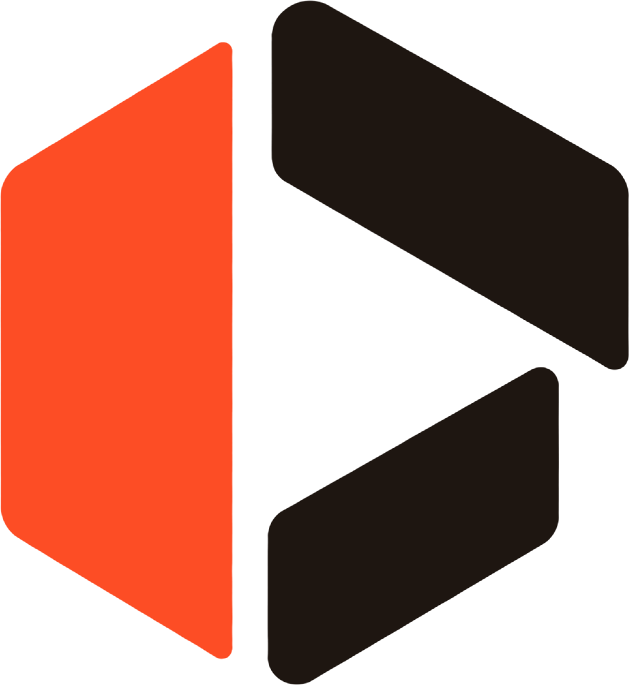
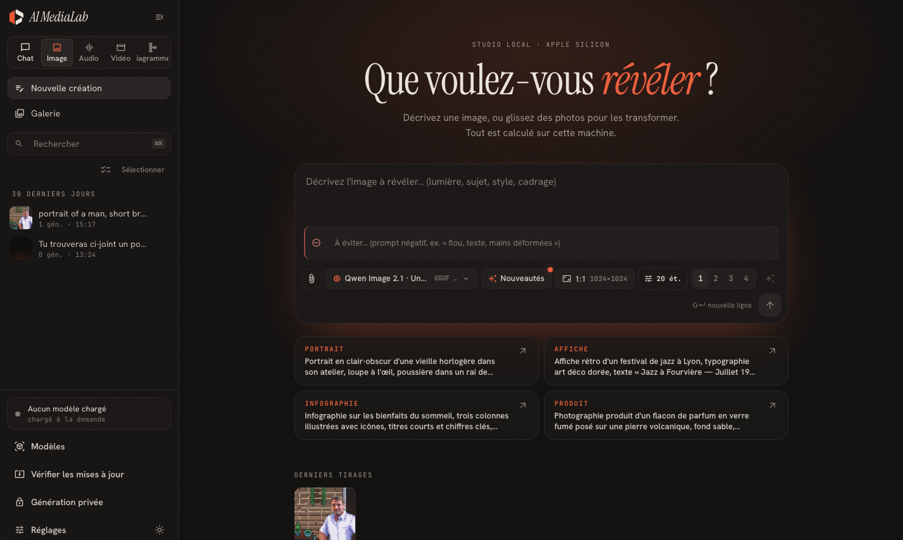

<p align="center">
  <picture>
    <source media="(prefers-color-scheme: dark)" srcset="logos/logo_transparent_fond_sombre.png">
    
  </picture>
</p>

<h1 align="center">AI MediaLab</h1>

<p align="center">
  A local studio for images, speech and video, driven like a chat. Open models run on your machine,<br>
  with no account, no cloud service and no data leaving your computer.
</p>

<p align="center">
  <a href="LICENSE"></a>
  
  
</p>

<p align="center">
  
</p>

## What it does

- **Image**: text to image, image to image, instruction-based editing with up to several reference images, LoRA and face
  references (Qwen Image, Z-Image, Stable Diffusion XL and fine-tunes).
- **Audio**: speech synthesis, voice cloning, voice design from a description, multi-speaker dialogue and transcription
  (Kokoro, Pocket TTS, Qwen3-TTS, Chatterbox, Whisper).
- **Video**: text to video, image to video and video editing (Wan 2.2, LTX, HunyuanVideo, CogVideoX and others).
- **Chat**: local language models (GGUF through llama.cpp) that can also call the creation tools above, search the web
  (optional) and render Markdown, code and formulas.
- **Diagrams**: organization charts, flowcharts, sequences and schemas.
- **Private generation**: a mode that keeps nothing on disk.
- One shared library, queue, download manager and memory planner; Hugging Face search to add your own models; update
  advisor for installed engines and models; French and English interface.

Hardware: Metal (Apple Silicon), NVIDIA (CUDA), AMD (ROCm) and any Vulkan GPU, with a CPU fallback. The full inventory of what is
built (and what has never been run) is in [FEATURES.md](FEATURES.md).

## Download

Prebuilt packages are attached to each [GitHub release](https://github.com/svax974/ai-medialab/releases/latest).

| Platform | File | Status |
|---|---|---|
| macOS 14+, Apple Silicon | `AI.MediaLab_<version>_aarch64.dmg` | Built and used by the author |
| Windows 10/11, x64 | `AI-MediaLab-<version>-win-x64.zip` (portable: extract to a short path such as `C:\App`, run `AI MediaLab.exe`; needs the WebView2 runtime) | **Experimental**: never run on Windows hardware yet |
| Linux x64 | `AI.MediaLab_<version>_amd64.AppImage` (and `.deb`) | **Experimental**: never run on Linux hardware yet |

Each file has a `.sha256` next to it. A package larger than 2 GiB is split into `.part-aa`, `.part-ab`…; the release notes say how to
reassemble it.

**The packages are not code-signed**, so your OS warns on first launch:

- macOS: drag the app to `/Applications`, then right-click → Open, or run
  `xattr -dr com.apple.quarantine "/Applications/AI MediaLab.app"`.
- Windows: SmartScreen → *More info* → *Run anyway*.
- Linux: `chmod +x AI.MediaLab_*.AppImage && ./AI.MediaLab_*.AppImage` (needs FUSE 2, or run it with `--appimage-extract-and-run`).

### First launch

The installer is small on purpose: nothing heavy ships with it. When you pick a model for the first time, the app lists what it
will download (shared base data, the runtime engine for your GPU, the model) with sizes and the total, checks disk space and
memory, then installs everything in one go. Models are downloaded from [Hugging Face](https://huggingface.co) and **keep
their own licences**, shown in the model picker. Details: [docs/guide.md](docs/guide.md), "First launch".

Your data (conversations, library, voices, settings) lives in the OS per-user data folder of the app
(macOS: `~/Library/Application Support/app.aimedialab.studio/`), logs in its `logs/` subfolder.

## Build from source

Requirements: Node.js 22+, [uv](https://docs.astral.sh/uv/) and, for the desktop app, a Rust toolchain.

```sh
git clone --recurse-submodules https://github.com/svax974/ai-medialab.git
cd ai-medialab
(cd back && npm install) && (cd front && npm install)
./scripts/run.sh dev        # Nest (3000) + Vite (5173) + engine (127.0.0.1:8000); open http://localhost:5173
```

Desktop packages (`.dmg`, `.AppImage`, installer), tests, the engine environment variables and the release procedure are in
[docs/guide.md](docs/guide.md). Memory warning for contributors: run the tests one file at a time, as explained there.

## How it is built

```
front/    React + MUI interface           back/     NestJS application server (SQLite)
engine/   FastAPI inference engine        desktop/  Tauri shell (packaging)
          (internal, 127.0.0.1 only)
```

The browser only talks to the NestJS server; the Python engine runs the models and holds no application state. Read
[ARCHITECTURE.md](ARCHITECTURE.md) first: it describes the processes, the contracts and the flows, and carries the map of
all the documentation. The project is built on the [vx-public](https://github.com/bccapps/WebAppTemplate-public) template (git
submodule, MIT).

## Contributing and security

See [CONTRIBUTING.md](CONTRIBUTING.md). To report a vulnerability, follow [SECURITY.md](SECURITY.md). Release notes:
[CHANGELOG.md](CHANGELOG.md).

## License

The code of this repository is released under the [MIT License](LICENSE). The app does not redistribute any model: models and
engines it downloads keep their own licences, and the third-party components inside the installers are listed in
[THIRD_PARTY_LICENSES.md](THIRD_PARTY_LICENSES.md) (their texts ship in the app's `licenses/` folder). Check a model's licence before
any commercial use: some are non-commercial or carry usage restrictions.
